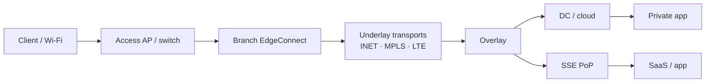
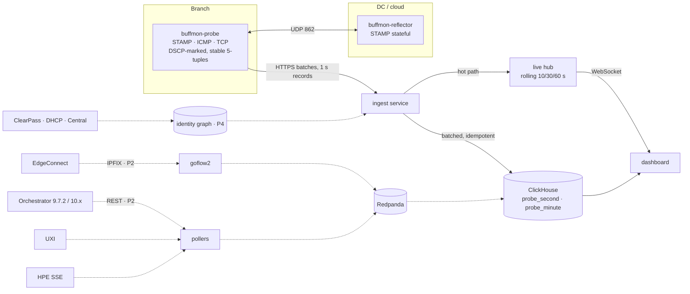

# buffmon — design (v0.1)

End-user network experience monitoring for HPE Aruba Networking EdgeConnect
SD-WAN + HPE SSE environments. Synthetic probes are the primary real-time
signal; EdgeConnect, UXI, SSE and passive TCP analysis explain *where* and *why*.

Status: Phase 1 (real-time probes) is implemented in this repository. Everything
after Phase 1 is design only.

## 1. Goals and non-goals

**Goals**

- A live view (seconds) of loss, latency and jitter per site and per application
  class, from probes that ride the same path as the user traffic they represent.
- Fault localisation by segment: client/Wi-Fi → access → branch edge → underlay
  → overlay → DC or SSE PoP → application.
- Near-real-time (about 1 min) traffic context from EdgeConnect: which overlay and
  transport carried which flows, underlay loss before FEC against what users got.
- Analytic views (5–15 min): good vs bad TCP sessions over time, UXI, SSE
  experience data, all joined to the same sites, devices and users.

**Non-goals (for now)**

- A single opaque "experience score". Health is shown per segment and per app
  class, as threshold compliance plus session good/bad ratios. An exec roll-up
  may come later and must always drill down to a segment and a metric.
- Writes to any network device. Every integration is read-only.

## 2. Decisions that shape everything else

| # | Decision | Why |
|---|---|---|
| D1 | **Probes must follow the user's path.** Every probe session has an app class, a DSCP mark and a stable source port. In Phase 2 the probe's own IPFIX record is used to confirm which overlay and transport it actually took. | EdgeConnect steers by business-intent overlay (app/DSCP/ACL). A probe on the wrong overlay measures a path nobody uses. |
| D2 | **Loss is reported with its sample count and a 95% upper bound** (Wilson score interval). Real-time loss uses 10 s and 30 s rolling windows. | With zero losses in *n* packets the Wilson 95% bound is ≈3.84/*n* (the rule of three gives ≈3/*n*). Showing <1% takes about 380 packets: voice/video sessions run at 20 pps (600 per 30 s, bound ≈0.64%). At 10 pps the bound never drops below 1.26% and the status stays "insufficient samples". |
| D3 | **STAMP (RFC 8762), stateful reflector, is the quality probe.** ICMP is for reachability and topology only. TCP connect is for service reachability and handshake time. | ICMP is rate-limited and deprioritised by control-plane policing (SRX/MX/CX, cloud). Per-hop ICMP numbers are artefacts. |
| D4 | **Direction matters.** The stateful reflector's counter splits loss into forward and return. IPDV (RFC 3393/5481) is computed per direction; clock offset cancels out. One-way delay is reported only when both ends say they are synchronised, together with the combined error bound. | SD-WAN paths are frequently asymmetric. "Which direction" halves the search. |
| D5 | **The reflector reflects the DSCP and the packet size** it received. | So the return path is classified like the forward path, and there is no amplification. |
| D6 | **TTL is tracked in both directions** (reflector reports the TTL it saw; the probe reads the reply's TTL). | A cheap path-change detector at 1 s resolution. |
| D7 | **Packet-train dispersion is a periodic capacity *estimate*,** run from wired site probes to our own reflectors, kept out of the health status until validated. | Dispersion is distorted by Wi-Fi contention/aggregation, shapers and policers, EdgeConnect FEC/POC/shaping, and host interrupt coalescing. |
| D8 | **Correlation goes through a time-aware identity graph,** never through MAC or IP alone. Join key: (site, VRF/segment, IP, time window) → MAC → device → user. Identity is attached when data arrives, not at query time. | EdgeConnect and SSE never see client MACs; MACs are randomised; IPs churn and overlap across sites and VRFs. |
| D9 | **UXI is a control group,** joined by site / AP / BSSID / SSID / test target, never by user. | UXI fine + users bad on the same AP → client side. Both bad → infrastructure. |
| D10 | **Passive TCP analysis needs care in where it captures.** EdgeConnect TCP acceleration terminates TCP on the appliance; SSE agents encapsulate; QUIC has no TCP signals; asymmetric paths give a SPAN half a conversation. Sensors go where traffic is not proxied or tunnelled, and each session verdict records where it was observed. | Otherwise "retransmissions" describe the LAN leg only. |

## 3. Segment model

Each segment's evidence:

| Segment | Real-time (probes) | Near-real-time / analytic |
|---|---|---|
| Client / Wi-Fi | — (site probes are wired) | UXI sensor tests, ClearPass/Central client data |
| Access | ICMP to default gateway | AOS-CX / Mist stats (later) |
| Branch edge | ICMP/STAMP to EdgeConnect LAN IP (if allowed) | Orchestrator appliance health |
| Underlay | — (hidden by the overlay) | Orchestrator tunnel stats per transport, pre-FEC loss |
| Overlay | STAMP to DC/cloud reflectors, per app-class DSCP | IPFIX: which overlay/transport each flow used; post-FEC loss |
| SSE PoP | TCP connect to SaaS through SSE | SSE experience/explore data |
| Application | TCP connect / handshake time | Passive TCP session verdicts, SSE app data |

**Localising a fault with nested targets.** Probe the gateway, the EdgeConnect LAN
interface, a DC reflector over the overlay, and a SaaS front door through SSE.
The first target that degrades marks the segment. EdgeConnect underlay statistics
then say whether the overlay problem is an underlay problem.

## 4. Architecture

Dashed = later phases. Phase 1 writes straight from ingest to ClickHouse; the bus
(Redpanda) arrives in Phase 2, when there is more than one producer.

**Stack.** Probe and reflector in Rust: precise pacing, kernel receive
timestamps, raw sockets, no runtime. Services in Python 3.12 (FastAPI). ClickHouse
25.8 LTS for time series and flows. goflow2 for IPFIX (no hand-written flow
collector). Dashboard: dependency-free HTML/JS served by the ingest service.

## 5. Probe measurement method (Phase 1)

**STAMP session** (one per target × app class):

- Sender transmits 44-byte unauthenticated STAMP test packets (larger if
  `size` is set) at `pps`, from a fixed source port, with IP TOS = `dscp << 2`.
- T1 = sender transmit time (user space, CLOCK_REALTIME, immediately before
  `send`). T2/T3 = reflector receive/transmit time. T4 = sender receive time from
  the kernel (`SO_TIMESTAMPNS`), falling back to user space and flagged.
- RTT = (T4 − T1) − (T3 − T2): reflector dwell time removed.
- Forward IPDV between consecutive replies i, j: (T2ⱼ − T1ⱼ) − (T2ᵢ − T1ᵢ).
  Return IPDV: (T4ⱼ − T3ⱼ) − (T4ᵢ − T3ᵢ). Reported as mean |IPDV|.
- One-way delay (T2 − T1, T4 − T3) only when both ends set the STAMP "S" bit
  (from `adjtimex`), with the combined error estimate.
- A packet with no reply after `timeout_ms` (default 2000) is lost. A reply after
  that is counted `late`, never `received`.
- Duplicates and reordering (sequence below the highest seen) are counted.
- Forward/return loss split: the reflector numbers packets per session
  (RFC 8762 stateful mode). Between two replies (s, r) and (s′, r′):
  forward losses = (s′ − s) − (r′ − r). Return losses = total − forward.

**ICMP echo**: raw socket (`CAP_NET_RAW`), falls back to unprivileged datagram
ICMP. Loss and RTT, labelled as reachability.

**TCP connect**: non-blocking connect with timeout, DSCP-marked; RTT from the
kernel's `TCP_INFO` handshake RTT when available. Failures are classified
(timeout, refused, unreachable, dns).

**Records.** Each session emits one record per 1-second bucket, keyed by the
*send* time of the packets in it. A bucket is emitted as soon as its second has
ended and every packet in it is resolved: normally one RTT after the second ends,
up to `timeout` later when a packet is lost, and up to a further 3 s when the
forward/return split is waiting for the next reply. See `docs/PROBE-RECORD.md`
for the wire format.

## 6. Health model

Per session, over rolling windows:

- **Loss**: point estimate and 95% Wilson upper bound over 30 s. If the point
  estimate is within target but the bound is not, the status is
  "insufficient samples", not "good".
- **Latency**: RTT p50/p95 over 10 s and 30 s.
- **Jitter**: mean |IPDV| per direction (STAMP), mean |ΔRTT| otherwise.
- **Status** per app class: `good`, `degraded`, `bad`, `no-data`. Thresholds live
  in `services/thresholds.yaml`. The defaults are starting points: voice/video
  from Microsoft's published Teams network targets (client to Microsoft edge:
  RTT < 100 ms, loss < 1% per 15 s, jitter < 30 ms per 15 s), with ITU-T G.114
  as the outer limit for one-way delay. Tune per customer.

## 7. Correlation keys by source

| Source | Native keys | Joins through |
|---|---|---|
| Site probe | probe_id, site, session 5-tuple, DSCP | site; 5-tuple ↔ IPFIX (P2) |
| EdgeConnect IPFIX | 5-tuple, appliance, overlay/tunnel, app ID (verify per release) | (site, VRF, IP, t) |
| Orchestrator stats | appliance, tunnel, overlay, transport | site, appliance |
| ClearPass / DHCP / Central | MAC, IP, user, AP/NAS, lease or session interval | builds the identity graph |
| HPE SSE | user, device, app, PoP; source IP often NATed | user/device; IP only if pre-NAT IP is present |
| UXI | sensor, site, SSID, BSSID/AP, test target | location and target, never user |
| Passive TCP | 5-tuple, observation point | (site, VRF, IP, t) |

## 8. Storage

- `probe_second`: one row per (probe, session, second). `ReplacingMergeTree`
  ordered by (probe_id, session, ts) so a retried batch cannot double count.
  RTT samples are kept as an array so percentiles over any window are exact.
  30-day TTL.
- `probe_minute`: `AggregatingMergeTree` rollup via materialised view, 400-day
  TTL.
- Duplicates are stopped at three points. (1) Ingest drops records whose key it
  has seen in the last 15 minutes (in memory), which catches probe retries.
  (2) Each ClickHouse insert carries an `insert_deduplication_token` with
  `deduplicate_blocks_in_dependent_materialized_views = 1`, so an ingest → ClickHouse
  retry is applied once to both tables. (3) `probe_second` is a
  `ReplacingMergeTree`, so any duplicate that still lands collapses on merge.
  Known gap: if the ingest service restarts and a probe then re-sends a batch,
  (1) has forgotten it and (2) sees a new block, so `probe_minute` counts it
  twice; `probe_second` is still exact after merge. Bounded by the probe's
  retry window; closing it needs a persistent dedup key store (Phase 2, with
  the bus).

## 9. Security

- Probe → ingest over HTTPS using the OS trust store (enterprise CAs work) with an
  optional explicit proxy. Per-probe bearer tokens, stored hashed on the server,
  bound to the probe_id; a probe cannot write another probe's records.
- Secrets never live in config files: systemd `LoadCredential=` or an env var.
- Probe runs with `CAP_NET_RAW` only; reflector with `CAP_NET_BIND_SERVICE` (port
  862). No root, no `privileged` containers.
- Reflector: source allowlist (required), per-source rate limit, bounded session
  table, reply size equal to request size (no amplification).
- Dashboard and read APIs require a login (token → signed, expiring cookie). Put
  an identity-aware proxy in front for production.
- Every external integration is read-only. Probe traffic on a non-lab network
  needs an explicit go-ahead: packet trains (P3) are bursty by design.

## 10. Phases

| Phase | Scope | Done when |
|---|---|---|
| **P1 (this PR)** | STAMP sender + stateful reflector, ICMP, TCP; ingest with auth and dedup; ClickHouse; live dashboard; systemd units | In the lab, loss/latency/jitter per site and target reach the dashboard within 5 s; an injected 2% loss (`tc netem`) shows within 30 s, attributed to the right direction |
| P2 | EdgeConnect: IPFIX via goflow2 → ClickHouse; Orchestrator poller for tunnel/overlay stats and alarms, 9.7.2 and 10.x; probe path validation; underlay vs delivered loss | Each probe session shows the appliance and interfaces it actually used; pre-FEC vs post-FEC loss next to probe loss |
| P3 | Path characterisation: Paris-style traceroute with change detection; packet-train capacity estimate | Path changes flagged within one cycle; capacity estimate within ±20% of a known shaped rate on wired lab links |
| P4 | Identity graph: ClearPass, DHCP, Central/Mist; enrichment on arrival | Any IP at any time resolves to MAC, device and user where the sources know them |
| P5 | UXI and HPE SSE ingestion; segment view; UXI as control group | One screen shows, per site, which segment is degraded and the evidence for it |
| P6 | Passive TCP: SPAN sensor where traffic is not proxied or tunnelled; good/bad session % over time; reports | Hourly good-session % per site and app, with the observation point recorded |

### Phase 2 status

- Done: per-target threshold overrides; flow pipeline (standard IPFIX
  elements) with exporter allowlist and probe path validation; Orchestrator
  10.x tunnel stats, verified against a live 10.0.0.40724 Orchestrator
  (`deploy/orchestrator/README.md`); tunnel health on the dashboard and next to
  each probe's path.
- Deviation: no Redpanda yet. One collector process writes straight to
  ClickHouse with the same batching and dedup guarantees as ingest; the bus
  comes in when there is more than one collector or the flow rate needs it.
- Open: EdgeConnect enterprise IPFIX elements (overlay/tunnel per flow), which
  would tie a probe to its overlay directly instead of via its appliance; the
  9.7.2 mapping; Orchestrator's loss-percentage scale under real loss.

## 11. What has to be confirmed in the lab before P2+

Not guessed here; each changes a design detail.

- ~~Orchestrator 10.x: tunnel/overlay statistics endpoints, granularity, loss
  before/after FEC.~~ Confirmed on 10.0.0.40724: per-minute, per tunnel, loss
  and reorder before/after correction, latency, jitter, MOS. Still needed: a
  9.7.2 export (if any Orchestrator still runs 9.7.2).
- EdgeConnect IPFIX: template fields on your ECOS releases (overlay/tunnel ID,
  application, segment/VRF). A short pcap of the export is enough.
- Which sites run TCP acceleration (affects passive TCP placement).
- UXI: data access path (API or export) and fields.
- HPE SSE: what Explore and Experience data can be exported, whether it carries
  the pre-NAT client IP and device ID, and whether the agent tunnels ICMP/UDP.
- ClearPass: RADIUS accounting / Insight / API access for MAC↔IP↔user bindings.
